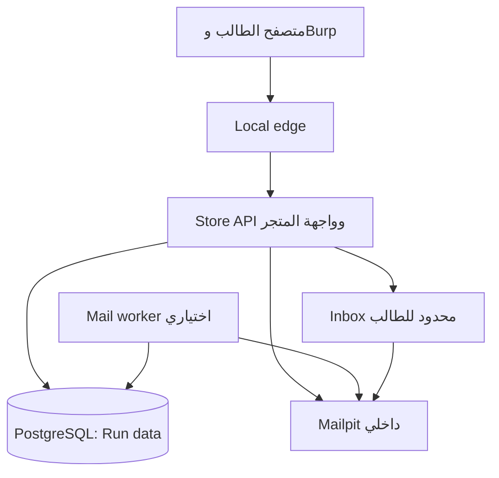

# RVU Commerce — خطة البحث والتصميم والتنفيذ
**RVU Mentorship Camp | By: Ramez Medhat | 9 أكتوبر 2026**

**حالة الوثيقة:** تخطيط فقط. لا يوجد كود تطبيق أو Docker Compose أو تنفيذ للثغرات في هذه المرحلة.
**نطاق المراجعة:** وصف وحل رسمي منشور لكل واحد من الـ18 لاب. لم أشغّل Instances على PortSwigger ولم أختبر تطبيق RVU Commerce؛ نتائج التشغيل ومعدلات نجاح السباقات تظل معايير قبول مستقبلية، وليست نتائج قياس.
**تمييز الأدلة:** تفاصيل «الأصل» مأخوذة من المصادر الرسمية؛ تفسير السبب والـInvariant تحليل مبني عليها؛ تصميم RVU Commerce اقتراح هندسي أصلي. تفاصيل الخلفية التي لا يعرضها الحل الرسمي لا تُنسب لكود PortSwigger.

**القرار:** منتج واحد قادر على استيعاب المفاهيم الـ18 على مراحل، بواجهات متماسكة وسيناريوهات مستقلة. النسخة الأولى 8 سيناريوهات؛ السيشن الأساسية تختار 5 منها. نضيف 6 في المرحلة التالية، ثم 4 متخصصة بعد إثبات آلياتها تقنيًا. لا نفعّل جميع العيوب على نفس الـWorkflow في وقت واحد.

## 1 — Research Matrix: مراجعة الـ18 لاب

الاختصارات: A = Apprentice، P = Practitioner، E = Expert حسب تصنيف PortSwigger. «المسار» تصنيفنا التعليمي وقد يختلف؛ نقل لاب Practitioner للمسار المتخصص لا يغيّر تصنيفه الرسمي.

### Business Logic

| ID | اللاب / المستوى الرسمي | الآلية الفعلية والحل المنشور باختصار | السبب والقاعدة المكسورة | قيمته وتوظيفه عندنا |
|---|---|---|---|---|
| B01 | Excessive trust in client-side controls / A | تغيير سعر مرسل في إضافة المنتج، ثم إتمام شراء بقيمة أقل. | العميل يحدد قيمة مالية موثوقة؛ السعر النهائي يجب أن يأتي من التسعير المعتمد. | تمهيد قصير. V1 / Core. عرض سعر منتج مخصص. [S01] |
| B02 | High-level logic vulnerability / A | كمية سالبة لمنتج آخر تخفض إجمالي سلة فيها المنتج المطلوب. | التحقق من الإجمالي لا يضمن صحة كل بند؛ كمية الشراء لا تكون سالبة. | يميز صحة البند عن صحة المجموع. V1 / تدريب لاحق. [S02] |
| B03 | Inconsistent security controls / A | تسجيل وتأكيد بريد مملوك، ثم تغييره لبريد شركة دون إثبات ملكية جديد؛ تفتح صلاحيات إدارية. | هوية البريد تتغير بينما الثقة تستمر؛ إثبات الملكية يجب أن يخص القيمة الحالية. | مهم، لكن يتقاطع مع Account Security. V2 / Advanced. بوابة موظفي الشركة. [S03] |
| B04 | Flawed enforcement of business rules / A | تكرار الكوبون نفسه مباشرة يُرفض؛ التناوب بين كوبونين يعيد تطبيقهما. | فحص آخر استخدام بدل تاريخ الاستخدام ذي الصلة؛ قيد مرة واحدة لكل كوبون/طلب. | Core قوي لفهم History-dependent rules. V1. [S04] |
| B05 | Low-level logic flaw / P | كميات موجبة متكررة تجعل حساب السعر يتجاوز مدى integer ذي 32 بت، ثم يُضبط المجموع لإتمام الشراء. | التفاف عددي في حساب مالي؛ المجموع يجب أن يطابق الحساب الرياضي داخل الحدود المسموحة. | يختلف جذريًا عن كمية سالبة. V2. Legacy bulk quotation. [S05] |
| B06 | Inconsistent handling of exceptional input / P | بريد طويل تصل له رسالة التأكيد كاملة لكن يُخزن مقصوصًا عند 255 حرفًا، بحيث ينتهي المخزن بدومين الشركة. | اختلاف الهوية بين الإرسال والتخزين والتفويض؛ العنوان المؤكد يجب أن يساوي المعتمد. | درس تمثيل البيانات؛ ليس UTF-7 parsing. V2. Legacy onboarding. [S06] |
| B07 | Weak isolation on dual-use endpoint / P | حذف current-password يفتح تغيير كلمة المرور دون إثباتها، وusername يحدد حسابًا آخر. | اختيار مسار إداري من المدخلات بدل صلاحيات الفاعل؛ تغيير كلمة مرور الغير يحتاج تفويضًا مستقلاً. | قوي لكن يستطيع اختصار تحديات ATO. V2 مع عزل. [S07] |
| B08 | Insufficient workflow validation / P | تسجيل طلب صحيح، ثم إعادة طلب التأكيد مع سلة جديدة لإكمالها دون خصم قيمتها. | الاعتماد على وصول المستخدم لخطوة النهاية بدل التحقق من انتقال الحالة والدفع المرتبط بها. | Core أساسي. V1. Order confirmation. [S08] |
| B09 | Authentication bypass via flawed state machine / P | إسقاط طلب role-selector بعد تسجيل الدخول يترك دورًا افتراضيًا إداريًا. | Session ناقصة التهيئة تُعامل كحالة ذات امتياز؛ يجب رفض الوصول حتى اكتمال السياق. | ليس مجرد «تخطّي MFA». V2. Corporate workspace selection. [S09] |
| B10 | Infinite money logic flaw / P | شراء Gift Card بخصم ثم استرداد قيمتها الاسمية يولّد رصيدًا إضافيًا، وتُعاد الدورة. | عدم اتساق قواعد الخصم والرصيد عبر ميزتين؛ قيمة مخزنة قابلة لإعادة الإنفاق تموّل إنشاء قيمة أكبر بلا حد سياسة. | Core قوي لتركيب Features. V1. Stored-value vouchers. [S10] |
| B11 | Authentication bypass via encryption oracle / P | رسائل خطأ مشفرة تسمح بالحصول على ciphertext وفكّه عبر مسار آخر؛ محاذاة الكتل وإعادة استخدام الناتج ككوكي دخول. | تداخل أغراض التشفير وغياب ربط موثوق بالسياق وسلامة الرسالة؛ توكن إشعار لا يصبح هوية. | تخصص Cryptography + Auth. مرحلة مستقلة، لا يُختزل إلى Base64. [S11] |
| B12 | Bypassing access controls using email address parsing discrepancies / E | اختلاف معالجة encoded-word وUTF-7 يجعل فحص الدومين يرى عنوانًا بينما الإرسال يصل لصندوق آخر؛ تأكيد الحساب يمنح الوصول. | اختلاف Parser المعتمد للسياسة عن تفسير عنوان التسليم. | Expert مستقل مع Email adapter حقيقي مثبت الإصدارات. [S12] |

### Race Conditions والتوقيت

| ID | اللاب / المستوى الرسمي | الآلية الفعلية والحل المنشور باختصار | السبب والقاعدة المكسورة | قيمته وتوظيفه عندنا |
|---|---|---|---|---|
| R01 | Limit overrun race conditions / A | تطبيق كوبون بالتتابع يقبل مرة، وبالتوازي قد يقبله عدة مرات، ثم يُثبت أثر السعر بالشراء. | Check-then-act على نفس مورد الاستخدام بدون حماية كافية. | Core للانتقال من التكرار للتزامن. V1. Single-use checkout discount. [S13] |
| R02 | Bypassing rate limits via race conditions / P | حد محاولات لكل username يمكن تخطيه بطلبات دخول متزامنة قبل تحديث عدد المحاولات؛ تُستخدم قائمة تدريبية للوصول للحساب. | حجز حصة المحاولة وتحديثها ليسا ذريين؛ عدد عمليات التحقق الفعلية يتجاوز الحد. | Advanced، يضيف موضوع quota وليس مجرد كوبون آخر. V2. [S14] |
| R03 | Multi-endpoint race conditions / P | إضافة منتج أثناء checkout بين التحقق والتأكيد تؤدي إلى شراء محتوى أغلى؛ تُقاس فروق التوقيت ويُستخدم تسخين الاتصال عند الحاجة. | اعتماد الدفع على نسخة للسلة وتنفيذ الطلب على نسخة مختلفة. | V1 / Advanced. يوسع الفكرة من endpoint واحد إلى تفاعل endpointين. [S15] |
| R04 | Single-endpoint race conditions / P | طلبا تغيير بريد متوازيان يخلطان المستلم مع بيانات pending email/token؛ رابط يصل للمهاجم يثبت بريدًا آخر له دعوة Admin. | مهمة البريد تقرأ حالة متغيرة لاحقًا بدل الاحتفاظ بطلب تغيير ثابت ومترابط. | V1 / Advanced. ليس تكرار نفس الكوبون؛ Binding race. [S16] |
| R05 | Exploiting time-sensitive vulnerabilities / P | توقيت reset لحسابين قد ينتج توكنًا متطابقًا؛ يلزم تجاوز تسلسل المعالجة المرتبط بالجلسة باستخدام جلستين في اللاب الأصلي. | توليد توكن ضعيف مرتبط بالوقت وغير مميز لهوية الحساب بالقدر الكافي. | المصدر ينص صراحةً أنه ليس Race Condition. مسار متخصص Auth/Crypto. [S17] |
| R06 | Partial construction race conditions / E | تسجيل حساب مع محاولة تأكيد أثناء فترة عدم اكتمال تهيئة التوكن؛ تمثيل parameter كمصفوفة يتجاوز رفض القيمة الفارغة في الحل. | ظهور كائن ناقص التهيئة، مع معالجة غير آمنة لنوع/قيمة التوكن. | Expert مستقل. لا يكفي Request سريع أو token فارغ دون النافذة الزمنية. [S18] |

### متطلبات النجاح وحدود الاستنتاج

| المجموعة | المتطلبات في الأصل | الإثبات الصحيح |
|---|---|---|
| B01/B02/B04/B05/B08/B10 | حساب شراء، رصيد محدود، الوصول للطلبات ذات الصلة | طلب نهائي ومحتوياته مع صافي الخصم من الرصيد؛ لا تكفي سلة رخيصة. |
| B03/B06/B12 | صندوق بريد يملكه المتدرب، وقاعدة صلاحيات ترتبط بعنوان/دومين البريد | تأكيد يصل لصندوق مسموح، ثم وصول فعلي لوظيفة أعلى. |
| B07/B09/B11 | وصول للمسار المستخدم، وحالة حساب/جلسة أو كوكي قابلة لإعادة الاستخدام | إنشاء Session/امتياز فعلي؛ لا يكفي تغيّر رسالة أو ظهور رابط. |
| R01/R03 | حالة مالية مشتركة ونافذة معالجة متداخلة | العملية المتتابعة محمية؛ العملية المتوازية تكسر قاعدة مالية قابلة للقياس. |
| R02 | حساب تدريبي له حد محاولات وقائمة مرشحات تدريبية | تنفيذ تحقق أكثر من الحصة ثم دخول للحساب المستهدف داخل السيناريو. |
| R04 | حساب، صندوق مملوك، بريد آخر مرتبط بدعوة إدارية | mismatch بين مستلم الرسالة والهوية المثبتة، ثم قبول دعوة أعلى. |
| R05 | reset لحساب مملوك وآخر تدريبي، وتقارب توقيت كافٍ | توكن الحساب المملوك يقبل لإعادة تعيين الآخر ثم دخول صحيح. |
| R06 | حساب جديد لكل محاولة، وفترة ظهور كائن ناقص | تأكيد حساب دون وصول لصندوقه ثم صلاحية فعالة؛ مع trace يثبت التداخل. |

## 2 — التوصية النقدية

### هل ننفذ الجميع؟

**نخطط لدعمهم جميعًا، وننفذهم تدريجيًا.** القيمة في اختلاف أسباب الخلل، وليست في عدد الأسماء على الشاشة. تشغيل الـ18 معًا على الحالة نفسها يفسد التعلم: B01 يخفض السعر فيلغي الحاجة إلى R03؛ B07 يمنح حساب Admin فيتجاوز تحديات البريد؛ B10 يرفع الرصيد فيزيل شرط نقص الأموال من اختبارات الشراء.

| معيار | تفعيل الكل دفعة واحدة | القرار المقترح |
|---|---|---|
| القيمة التعليمية | حمل معرفي كبير وتسطيح فروق الأسباب | خمس تجارب Core في السيشن، ثم انتقال تدريجي. |
| الواقعية | Features كثيرة وعيوب تتنافس على نفس النتيجة | متجر واحد، وسياسات سيناريوهات معزولة بالخلفية. |
| الصعوبة | أسهل استغلال يختصر الأصعب | بيانات جديدة وهوية وسلة مستقلة لكل سيناريو. |
| الوقت | 18 حلًا مع التطبيق والتحليل لا تناسب 3 ساعات | 5 داخل السيشن؛ 3 واجب/جلسة تالية في V1. |
| التعقيد | Crypto/Email semantics تجعل الإصدار الأول هشًا | بوابات إثبات تقنية للتخصصات قبل دمجها. |
| الموثوقية | نتائج السباق تتغير مع الجهاز وDB pool | اختبار تتابع/تزامن، trace، ونسخة مصححة. |
| الصيانة | flags عشوائية في كل middleware | استراتيجيات محددة لكل Workflow، وملف تعريف إصدار ثابت. |
| النشر والموارد | عشرات الخدمات غير لازمة | 4 خدمات أساسية، worker اختياري. |
| جودة المخرجات | «Solved» لا يثبت السبب | تقييم الفرضية والأثر والسبب والإصلاح. |

### تقسيم المحتوى الدقيق

| الإصدار/المسار | السيناريوهات | العدد |
|---|---|---:|
| V1 — Core مباشر | B01، B04، B08، B10، R01 | 5 |
| V1 — Advanced بعد السيشن | B02، R03، R04 | 3 |
| V2 — Advanced | B03، B05، B06، B07، B09، R02 | 6 |
| Specialist/Expert Pack | B11، B12، R05، R06 | 4 |
| الإجمالي النهائي المخطط | جميع أفكار المصدر مع الحفاظ على الفروق | 18 |

الـ18 تُقدّم عمليًا على نحو 4–6 لقاءات بحسب سرعة الطلاب، مع واجبات؛ هذا تقدير تخطيط لا مدة ثابتة.

### الدمج المفيد والدمج المضلل

- B01 وB02: نفس شاشة السلة، تجربتان ببيانات وتقييم مستقل؛ تغيير السعر غير الكمية السالبة.
- B04 وR01: نفس مجال الخصومات، baseline مختلف. في R01 يجب إغلاق عيب التناوب حتى لا يُحل السباق بالتتابع.
- B08 وR03: checkout واحد من منظور المنتج، لكن B08 انتقال حالة ناقص، وR03 اختلاف نسخة البيانات أثناء التزامن.
- B03 وB06 وB12: اشتراك في نظام الحسابات والبريد؛ تبقى آليات إعادة التحقق والقصّ والـParsing مستقلة.
- B09 وR06: يتناولان حالات غير مكتملة؛ B09 حالة مستمرة يمكن استغلالها دون سباق، وR06 نافذة مؤقتة أثناء الإنشاء.
- الاسترجاع وStale coupon eligibility من نقاشنا السابق يدخلان السلوك السليم وNegative controls في V1. إضافتهما كثغرات جديدة تكون توسعة لاحقة، ولا نحسبهما ضمن الـ18.

## 3 — فكرة التطبيق النهائية

**RVU Commerce** متجر أجهزة وإكسسوارات ومستلزمات عمل، مع بوابة مشتريات شركات وحسابات موظفين، ومحفظة وكروت قيمة مخزنة وخدمة عملاء. المنتجات مادية افتراضية؛ الشحن والدفع والتسويات داخل البيئة فقط.

### المستخدمون

| الدور | صلاحيات المنتج |
|---|---|
| Guest | تصفح الكتالوج، التسجيل، استرجاع الحساب. |
| Customer | السلة والشراء والرصيد والخصومات والاسترجاع وإعدادات الحساب. |
| Corporate buyer | طلبات مرتبطة بمؤسسة وانضمام بعضوية موثقة. |
| Support agent | إجراءات خدمة محددة؛ لا وصول للوحة التدريب. |
| Store admin | بيانات وإجراءات داخل متجر السيناريو فقط. |
| Instructor | التحكم في التدريب والإصدارات والأدلة، بنظام هوية منفصل تمامًا. |

Store admin دور داخل Target يمكن الاستيلاء عليه في التمرين؛ Instructor ليس مستخدمًا في جدول حسابات المتجر.

### Features المبررة

| Feature | سبب وجودها |
|---|---|
| كتالوج وسلة وطلبات | الاستخدام الطبيعي وتحديات القيمة والترتيب والتزامن. |
| عروض سعر/خدمة Legacy bulk | موضع طبيعي للثقة في سعر العميل والتحويل العددي القديم. |
| Wallet + Ledger | إثبات أثر مالي مستمر بدل عداد واجهة. |
| Coupons + Gift cards | History rules وFeature composition وLimit overrun. |
| Email verification/change/reset | تحديات الهوية والربط والتوقيت. |
| Corporate portal + Invites | أثر واضح لتأكيد بريد أو سياق عمل غير مستحق. |
| Support notifications + Remember me | وظائف تخدم B07 وB11 دون إضافة مدونة لا يحتاجها المنتج. |
| Refunds + reward reversal | اكتمال رحلة الشراء واختبارات سلوك صحيح؛ لا نفتح ثغرات إضافية افتراضيًا. |

واجهة متجر طبيعية: قوائم، بحث، تفاصيل منتج، سلة، checkout، فواتير، رصيد وتاريخ عمليات، إعدادات، مساعدة وسياسات. نصوص الواجهة والـAPI والأخطاء بالإنجليزية. إرشادات المدرب بالعربي. لا يظهر اسم الثغرة أو route مثل /race-lab في واجهة الهدف.

القواعد تظهر طبيعيًا في سياسة الخصومات والإرجاع والدعوات. لا نخفي شروط الـBusiness حتى تتحول معرفة الثغرة إلى تخمين، ولا نعرض أين ينكسر تنفيذها.

## 4 — User Journeys والحالات

### التسجيل والتحقق
Guest يسجل → Pending account → يصدر طلب تحقق مربوط بالحساب والعنوان والغرض → تصل رسالة للصندوق المحلي المملوك → تأكيد → Active customer. الطلب المنتهي أو المستخدم يُرفض؛ لا عضوية شركة من مجرد كتابة دومين.

### الدخول وسياق المؤسسة
Credentials صحيحة → Session محدودة إن كان اختيار المؤسسة مطلوبًا → اختيار من العضويات الفعلية → Session بسياق صالح. التصفح قبل اكتمال الخطوة لا يعطي default admin. عند تغيير الصلاحيات يدور/يتحدث سياق الجلسة من المصدر.

### الشراء والدفع
Cart open → Quote/version معتمد → Order awaiting payment → خصم محفظة افتراضي مرتبط بـorder/version/amount/currency → Payment settled → Order confirmed → Fulfilled افتراضيًا.
عرض صفحة التأكيد لا يخلق دفعًا. إعادة نفس الدفع تعيد نتيجته أو ترفض بدون خصم جديد. تعديل السلة لا يغير order snapshot المدفوع.

### الخصومات
العميل يرى شروط العرض → يطلب تطبيقه → تقييم فئة المنتج وحد الاستخدام والتراكم والتاريخ → حفظ discount application → إعادة حساب عند تعديل السلة وقبل تثبيت الطلب. في السيناريو السليم تستثنى أدوات القيمة المخزنة حسب السياسة المكتوبة.

### الكروت والمحفظة
شراء Gift Card بعملية صالحة → إصدار كود غير قابل للتخمين بعد settlement → استرداد مرة واحدة → قيد ائتماني في Ledger → استخدام الرصيد في طلب لاحق. منع إعادة الاسترداد مختلف عن منع دورة شراء بخصم متكرر؛ كلا القاعدتين مطلوب.

### الإلغاء والاسترجاع
طلب غير مدفوع يُلغى دون Refund. طلب مدفوع مستوفٍ للسياسة → Refund requested → احتساب صافي المستحق وغير المسترد سابقًا → Settlement للمحفظة → Full/partial refund. تُعكس مكافآت الشراء حسب سياسة محددة. مجموع الاسترجاعات لا يتجاوز المدفوع المستحق.

### تغيير البريد
عنوان حالي مؤكد يبقى صالحًا → Pending change مستقل → رسالة للعنوان الجديد → تأكيد نفس Change ID/version/address → تحديث الهوية ومراجعة العضويات. طلب جديد يبطل القديم أو يُدار كطلب مستقل وفق السياسة؛ لا يغيّر محتوى رسالة قيد الإرسال.

### إعادة تعيين كلمة المرور
طلب Reset لا يكشف وجود الحساب → توكن عشوائي قوي مربوط بالحساب والغرض والصلاحية → رسالة محلية → استهلاك مرة واحدة → تحديث كلمة المرور وإبطال الجلسات وفق السياسة. لا تُستخدم الساعة كمصدر وحيد أو غالب للسرية.

### الدخول للشركات والدعم
دعوة لمؤسسة ودور محدد → قبول من هوية بريد متحقق منها → عضوية مسجلة مستقلة عن نص البريد. عمليات الدعم تتطلب دور Support server-side، ولا تُختار صلاحيتها من وجود حقل أو غيابه.

---

## 5 — خريطة الثغرات ومواصفات السيناريوهات

كل بطاقة تذكر البنود الهندسية العشرين. IDs أسماء داخلية للمدرب فقط. الـEndpoints المقترحة عقود تصميم، ولم يتم تنفيذها. كل reset يعيد Run جديدًا وبيانات مستقلة؛ التفاصيل العامة في القسم 6.

### 5.1 — V1: الثمانية المختارة

### B01 — Custom workstation quote
- **1 الاسم / 2 المستوى:** عرض محطة عمل؛ Core تمهيدي.
- **3 Feature / 4 الرحلة السليمة:** تخصيص منتج؛ اختيار تجهيزات ثم قبول عرض سعر وشراء.
- **5 القواعد / 6 Invariant:** التجهيزات تحدد السعر؛ المبلغ المحصّل يساوي العرض المعتمد للسيرفر.
- **7 الأدوار / 8 البداية:** Customer؛ محفظة أقل من ثمن التجهيز الكامل، وسلة خالية.
- **9 API / 10 Entities:** POST /api/quotes، POST /api/cart/items، POST /api/checkout؛ products، quotes، cart_items، payments، orders.
- **11 السلوك الضعيف / 12 السبب:** خانة unitPrice من طلب قبول العرض تصبح السعر المحفوظ؛ ثقة مالية في العميل بدل quote binding.
- **13 المتطلبات / 14 المسار:** حساب وعرض صالح؛ خفض القيمة المرسلة ثم إكمال الشراء.
- **15 الأثر / 16 الإثبات:** امتلاك المنتج بتكلفة أقل؛ order item مطابق للتجهيز مع payment/ledger أقل من السعر المعتمد.
- **17 الصحيح / 18 العلاج:** تجاهل السعر غير الموثوق أو رفض mismatch؛ Quote ID/version محفوظ server-side مع صلاحية ومحتوى ثابت.
- **19 Reset / 20 الاعتماد:** حذف السلة والعروض والطلبات التجريبية وإعادة الرصيد؛ يحتاج checkout السليم؛ تعطيل سائر عيوب التسعير.

### B02 — Cart quantity reconciliation
- **1 الاسم / 2 المستوى:** تسوية كميات السلة؛ V1 واجب، مستوى متوسط.
- **3 Feature / 4 الرحلة:** إضافة/إزالة كميات؛ الطالب يعدل السلة ثم يشتري.
- **5 القواعد / 6 Invariant:** الـdelta السالب قد يكون مشروعًا للإزالة؛ لكن الكمية الناتجة لأي بند لا تقل عن صفر.
- **7 الأدوار / 8 البداية:** Customer؛ بند رخيص موجود ومنتج مطلوب أغلى من الرصيد.
- **9 API / 10 Entities:** PATCH /api/cart/items/{id}، POST /api/checkout؛ cart_items، product_prices، order_items، wallet_entries.
- **11 الضعيف / 12 السبب:** الإزالة تتجاوز الكمية الموجودة، ويُفحص إجمالي السلة فقط؛ نقص التحقق من الحالة الناتجة لكل بند.
- **13 المتطلبات / 14 المسار:** بند قابل للتعديل؛ إزالة أكثر من الموجود ثم إضافة المنتج الغالي وإتمام الطلب.
- **15 الأثر / 16 الإثبات:** بند سالب يعوض ثمن منتج فعلي؛ نسخة الطلب وصافي الدفع تثبتان الانحراف.
- **17 الصحيح / 18 العلاج:** رفض الانتقال لكمية سالبة مع بقاء الإزالة الطبيعية؛ domain validation + constraint للنسخة المصححة.
- **19 Reset / 20 الاعتماد:** سلة ورصيد وطلبات جديدة؛ لا B01 ولا overflow ولا كوبونات ضعيفة في نفس Run.

### B04 — Welcome promotions history
- **1 الاسم / 2 المستوى:** سجل عروض الترحيب؛ Core متوسط.
- **3 Feature / 4 الرحلة:** كوبونا ترحيب ونشرة؛ تطبيق المسموح ثم checkout.
- **5 القواعد / 6 Invariant:** كل كوبون مرة لكل طلب، والتراكم المسموح معلن؛ ترتيب المحاولات لا يعيد الأهلية.
- **7 الأدوار / 8 البداية:** Customer؛ طلب مؤهل وكوبونان مختلفان.
- **9 API / 10 Entities:** POST /api/cart/coupons، DELETE /api/cart/coupons/{id}؛ promotions، discount_applications، carts.
- **11 الضعيف / 12 السبب:** مقارنة الكود بآخر كود فقط؛ فقد تاريخ تطبيق القواعد.
- **13 المتطلبات / 14 المسار:** امتلاك الكودين؛ تجربة التكرار المباشر ثم التناوب وإكمال طلب.
- **15 الأثر / 16 الإثبات:** خصم متكرر فوق المسموح؛ سجل التطبيقات مع السعر النهائي المدفوع.
- **17 الصحيح / 18 العلاج:** هوية استخدام لكل coupon/order؛ تطبيق تاريخي واضح وقيود فريدة ذرية، مع سياسة حذف/إعادة تطبيق محددة.
- **19 Reset / 20 الاعتماد:** حذف applications وإعادة رصيد الطلب؛ الإصدار هذا لا يحتوي Race في مسار التطبيق حتى نعزل السبب.

### B08 — Returning customer order confirmation
- **1 الاسم / 2 المستوى:** تأكيد طلب لعميل عائد؛ Core متوسط.
- **3 Feature / 4 الرحلة:** شراء منتج ثم متابعة التأكيد والطلب من الحساب.
- **5 القواعد / 6 Invariant:** كل تأكيد يحتاج settlement لنفس order/amount/currency/version.
- **7 الأدوار / 8 البداية:** Customer؛ رصيد يكفي طلبًا صغيرًا فقط.
- **9 API / 10 Entities:** POST /api/checkout، POST /api/orders/{id}/confirm؛ checkout_sessions، payments، orders، order_items.
- **11 الضعيف / 12 السبب:** successful checkout marker في الجلسة يُقبل لطلب تالٍ؛ إثبات عملية غير مربوط بالطلب.
- **13 المتطلبات / 14 المسار:** إنهاء طلب صغير؛ إنشاء طلب أكبر واستخدام خطوة التأكيد مباشرة.
- **15 الأثر / 16 الإثبات:** طلب مؤكد دون دفع مطابق؛ order state وسجل المدفوعات والرصيد قبل/بعد.
- **17 الصحيح / 18 العلاج:** رفض الانتقال إلا بدفع صالح للطلب؛ state transition guard وorder-specific proof واستهلاك idempotent.
- **19 Reset / 20 الاعتماد:** إبطال checkout session وإعادة جميع الطلبات والرصيد؛ السعر والخصومات مصححة، ولا تُقبل تأكيدات وهمية من payment mock.

### B10 — Stored-value promotion loop
- **1 الاسم / 2 المستوى:** دورة كارت القيمة المخزنة؛ Core متوسط متقدم.
- **3 Feature / 4 الرحلة:** شراء كارت ثم استرداده بالمحفظة ثم استخدام الرصيد.
- **5 القواعد / 6 Invariant:** سياسة المتجر تستثني أدوات القيمة من الخصم؛ لا يولّد loop رصيدًا قابلًا للإنفاق أكبر من تكلفته.
- **7 الأدوار / 8 البداية:** Customer؛ 200 وحدة، كارت قيمته 100، خصم 20% مسموح به خطأً.
- **9 API / 10 Entities:** POST /api/checkout، POST /api/gift-cards/redeem؛ gift_cards، orders، wallet_transactions، ledger_entries، promotions.
- **11 الضعيف / 12 السبب:** شراء بـ80 واسترداد 100 ثم تمويل شراء جديد؛ عدم اتساق الأهلية عبر المنتجات المالية.
- **13 المتطلبات / 14 المسار:** الكوبون يُتاح للدورات وفق تنفيذ العرض؛ دورة واحدة ثم ثانية تثبت قابلية التكرار.
- **15 الأثر / 16 الإثبات:** الرصيد 200 ثم 220 ثم 240 دون تمويل إضافي؛ ربط كل debit/credit بالكارت والطلب.
- **17 الصحيح / 18 العلاج:** استبعاد كروت القيمة من العرض بحسب السياسة؛ تظل face value سليمة للكروت المشتراة بشكل مشروع.
- **19 Reset / 20 الاعتماد:** إبطال كل الكروت وعملياتها وإعادة التمويل؛ استرداد الكارت نفسه مؤمّن ذريًا، فلا نخلط العيب مع double redeem.

### R01 — Single-use checkout voucher
- **1 الاسم / 2 المستوى:** خصم استعمال واحد؛ Core مدخل للسباقات.
- **3 Feature / 4 الرحلة:** تطبيق خصم ثابت مرة على checkout ثم الشراء.
- **5 القواعد / 6 Invariant:** عدد منح منفعة نفس voucher/checkout لا يزيد عن واحد حتى مع التزامن.
- **7 الأدوار / 8 البداية:** Customer؛ checkout جديد لا يحتوي coupon applications.
- **9 API / 10 Entities:** POST /api/checkouts/{id}/voucher؛ voucher_claims، benefit_entries، checkouts.
- **11 الضعيف / 12 السبب:** قراءة عدم الاستخدام ثم إدراج منفعة وتحديث consumed لاحقًا بدون قفل/قيد يحمي الدلالة.
- **13 المتطلبات / 14 المسار:** طلبات لنفس checkout؛ قياس متتابع، Reset، إرسال متوازٍ، ثم تثبيت الطلب.
- **15 الأثر / 16 الإثبات:** أكثر من benefit entry لنفس الاستخدام؛ final payable أقل من المسموح وtrace يظهر overlap.
- **17 الصحيح / 18 العلاج:** حجز claim مرة واحدة بـunique key أو conditional update، والمنفعة في نفس transaction؛ retries لا تضيف أثرًا.
- **19 Reset / 20 الاعتماد:** checkout/coupon state جديدة قبل كل محاولة مقارنة؛ B04 مغلق، وكل إدخال منفعة له ID مستقل حتى لا يختفي التكرار في lost update.

### R03 — Checkout against a moving cart
- **1 الاسم / 2 المستوى:** الدفع لسلة تتغير؛ V1 Advanced.
- **3 Feature / 4 الرحلة:** إضافة منتجات ثم تحويل سلة إلى طلب مدفوع.
- **5 القواعد / 6 Invariant:** محتوى وقيمة الطلب المنفّذ يطابقان نسخة البيانات التي وافق عليها الدفع.
- **7 الأدوار / 8 البداية:** Customer؛ سلة صغيرة يستطيع دفعها، ومنتج إضافي يجعل الرصيد غير كافٍ.
- **9 API / 10 Entities:** POST /api/cart/items، POST /api/checkout؛ carts.version، cart_items، payments، order_snapshots.
- **11 الضعيف / 12 السبب:** حساب مبلغ من السلة ثم انتظار خطوة تسوية داخلية ثم إعادة قراءة العناصر للتنفيذ.
- **13 المتطلبات / 14 المسار:** endpointان يلمسان نفس cart؛ الإضافة قبل checkout ترفض، وبعده تخص سلة جديدة؛ التداخل قد يدخلها في الطلب القديم.
- **15 الأثر / 16 الإثبات:** محتوى أغلى من settlement؛ ربط نسخة السلة عند الفحص وعند التنفيذ مع ledger.
- **17 الصحيح / 18 العلاج:** snapshot غير قابل للتغيير للدفع والتنفيذ، أو version guard مع retry؛ قفل قصير إذا اقتضى التصميم.
- **19 Reset / 20 الاعتماد:** إلغاء intent التجريبي وإعادة الرصيد والسلة؛ عيب التأكيد B08 مغلق؛ لا قفل جلسة يصطفّ الطلبين تلقائيًا.

### R04 — Corporate email change delivery
- **1 الاسم / 2 المستوى:** خلط إثبات البريد أثناء التغيير؛ V1 Advanced.
- **3 Feature / 4 الرحلة:** تغيير البريد ثم قبول دعوة مؤسسة مرتبطة بالبريد المؤكد.
- **5 القواعد / 6 Invariant:** recipient وtoken وpending address وchange version يجب أن تخص طلب تغيير واحد.
- **7 الأدوار / 8 البداية:** Customer؛ صندوق مملوك، وعنوان شركة اصطناعي له دعوة Store admin ولا يملك الطالب صندوقه.
- **9 API / 10 Entities:** POST /api/account/email-changes، POST /api/account/email-confirmations، POST /api/invites/accept؛ email_changes، outbox_jobs، invitations، memberships.
- **11 الضعيف / 12 السبب:** job يحفظ recipient قديمًا ويقرأ pending token/address أحدث عند التجهيز؛ mutable state binding.
- **13 المتطلبات / 14 المسار:** تغيير متزامن لعنوان مملوك وآخر ذي دعوة؛ استخدام رابط يصل للصندوق المملوك لكنه يثبت الآخر.
- **15 الأثر / 16 الإثبات:** العضوية الإدارية تُمنح بعد الإثبات الخاطئ؛ رسالة وصندوق تسليم وchange IDs وعضوية نهائية.
- **17 الصحيح / 18 العلاج:** immutable change record؛ outbox يحمل مرجع نسخة ثابتة ولا يعيد قراءة current pending عشوائيًا.
- **19 Reset / 20 الاعتماد:** بريد ودعوات وعضويات وجلسات جديدة؛ worker مطلوب، ولا تُعرض رسائل العنوان المستهدف في Inbox الطالب.

### 5.2 — V2: ستة سيناريوهات إضافية

### B03 — Corporate identity after email update
- **1 الاسم / 2 المستوى:** ثقة الشركة بعد تحديث البريد؛ Advanced.
- **3 Feature / 4 الرحلة:** حساب مؤكد يطلب بريدًا جديدًا ثم يثبته.
- **5 القواعد / 6 Invariant:** المؤسسة تمنح membership بعد تحقق/دعوة معتبرة؛ verified status لا ينتقل من عنوان لآخر.
- **7 الأدوار / 8 البداية:** Customer مؤكد على صندوقه؛ لا membership للشركة.
- **9 API / 10 Entities:** PATCH /api/account/email، GET /api/corporate/orders؛ users، email_identities، memberships.
- **11 الضعيف / 12 السبب:** يُستبدل البريد وتبقى الثقة، وتستنتج البوابة الدور من الدومين؛ ضبط غير متسق بين التسجيل والتعديل.
- **13 المتطلبات / 14 المسار:** حساب مفعّل؛ تغيير لبريد مؤسسة اصطناعي ثم استخدام البوابة.
- **15 الأثر / 16 الإثبات:** وصول لطلبات مؤسسة داخل النسخة؛ email state وسجل إذن الوصول.
- **17 الصحيح / 18 العلاج:** طلب تغيير Pending وإثبات جديد، وعضوية مستقلة لا تستنتج من suffix وحده.
- **19 Reset / 20 الاعتماد:** إبطال الجلسات والهوية المضافة؛ منفصل عن B06/B12/R04.

### B05 — Legacy bulk invoice arithmetic
- **1 الاسم / 2 المستوى:** حساب فواتير الجملة القديم؛ Advanced.
- **3 Feature / 4 الرحلة:** طلب كميات كبيرة للحصول على عرض ثم شراء.
- **5 القواعد / 6 Invariant:** unit price × quantity والإجمالي يطابقان الحساب الدقيق، وكل كمية موجبة وضمن سياسة تراكمية.
- **7 الأدوار / 8 البداية:** Corporate buyer اصطناعي؛ رصيد محدود وقائمة أسعار كبيرة مناسبة للتجربة.
- **9 API / 10 Entities:** POST /api/bulk-quotes/items، POST /api/bulk-quotes/{id}/checkout؛ bulk_quotes، quote_lines، orders.
- **11 الضعيف / 12 السبب:** adapter توافق قديم يحوّل الإجمالي إلى signed 32-bit قبل الدفع؛ overflow wrapping مقصود ومحصور فيه.
- **13 المتطلبات / 14 المسار:** تجميع كميات مسموحة لكل طلب لبلوغ حد الحساب؛ ملاحظة انعكاس القيمة ثم إثبات فاتورة خاطئة.
- **15 الأثر / 16 الإثبات:** شراء بقيمة ملفوفة؛ exact total مقارنة بالـlegacy total والمحصّل.
- **17 الصحيح / 18 العلاج:** حساب integer/decimal دقيق وحدود تراكمية ورفض overflow قبل أي أثر.
- **19 Reset / 20 الاعتماد:** عروض ورصيد جديد؛ لا ندّعي أن PostgreSQL أو JavaScript Number يلتف تلقائيًا عند هذا الحد؛ يلزم adapter مثبت باختبار.

### B06 — Legacy corporate onboarding truncation
- **1 الاسم / 2 المستوى:** قصّ هوية التسجيل؛ Advanced.
- **3 Feature / 4 الرحلة:** تسجيل مشتري شركة ثم رسالة تأكيد.
- **5 القواعد / 6 Invariant:** القيمة المتحقق منها والمخزنة والمعتمدة للتفويض واحدة.
- **7 الأدوار / 8 البداية:** Guest؛ صندوق محلي مسموح له عناوين فرعية تدريبية.
- **9 API / 10 Entities:** POST /api/legacy-onboarding، POST /api/email/verify؛ registration_requests، email_identities، memberships.
- **11 الضعيف / 12 السبب:** SMTP يستعمل النص الكامل، وadapter التخزين يقص الهوية؛ دور الشركة يُستنتج من المقصوص.
- **13 المتطلبات / 14 المسار:** عنوان طويل مضبوط ينتهي الجزء المحفوظ بدومين شركة بينما يصل الكامل لصندوق المتدرب.
- **15 الأثر / 16 الإثبات:** تأكيد في صندوقه مع هوية محفوظة مختلفة وعضوية غير مستحقة.
- **17 الصحيح / 18 العلاج:** رفض الطول الزائد مبكرًا وتوحيد القيمة؛ لا تقص عنوانًا ليصبح هوية أخرى.
- **19 Reset / 20 الاعتماد:** طلبات التسجيل والبريد والعضويات؛ قص مقصود داخل adapter وليس سلوك VARCHAR مفترضًا؛ يحتاج سياسة mailbox routing واضحة.

### B07 — Shared password maintenance endpoint
- **1 الاسم / 2 المستوى:** مسار كلمة مرور مشترك؛ Advanced.
- **3 Feature / 4 الرحلة:** تغيير ذاتي بإثبات الحالي؛ موظف دعم ينفذ reset بمسار مصرح.
- **5 القواعد / 6 Invariant:** قرار المسار الإداري من هوية الفاعل وصلاحياته، وليس شكل body.
- **7 الأدوار / 8 البداية:** Customer ودور Support مستقل؛ مستخدم مستهدف اصطناعي معلوم.
- **9 API / 10 Entities:** POST /api/account/password؛ users، credential_versions، sessions، audit_events.
- **11 الضعيف / 12 السبب:** غياب currentPassword يختار فرع الدعم وtargetUser قابل للتعديل؛ missing authorization على الفرع.
- **13 المتطلبات / 14 المسار:** حساب عادي؛ حذف الحقل وتغيير target ثم الدخول للحساب التجريبي.
- **15 الأثر / 16 الإثبات:** Credential version يتغير للحساب الآخر ودخول فعلي به.
- **17 الصحيح / 18 العلاج:** فصل عقد الدعم عن الخدمة الذاتية مع تحقق server-side في كل فرع؛ التفريق بين absent وempty.
- **19 Reset / 20 الاعتماد:** كلمات المرور والجلسات وإصدار credentials؛ لا حساب Instructor ضمن قاعدة المتجر.

### B09 — Unfinished corporate session context
- **1 الاسم / 2 المستوى:** جلسة مؤسسة غير مكتملة؛ Advanced.
- **3 Feature / 4 الرحلة:** دخول، اختيار مساحة عمل من العضويات، ثم Dashboard.
- **5 القواعد / 6 Invariant:** Session غير مكتملة لا تملك صلاحيات عمل؛ لا دور مرتفع افتراضي.
- **7 الأدوار / 8 البداية:** Corporate buyer؛ عضوية محدودة واحدة.
- **9 API / 10 Entities:** POST /api/login، GET /workspace-selector، POST /api/session/context؛ sessions، memberships، workspace_contexts.
- **11 الضعيف / 12 السبب:** مسار Legacy يهيئ امتيازًا واسعًا وتأتي خطوة لاحقة لتقييده؛ fail-open initialization.
- **13 المتطلبات / 14 المسار:** تسجيل الدخول ثم تجاوز طلب تهيئة السياق والانتقال لوظيفة إدارية.
- **15 الأثر / 16 الإثبات:** عملية Store admin فعلية مع جلسة لم تكمل اختيار السياق.
- **17 الصحيح / 18 العلاج:** default deny وpending context؛ صلاحيات تُستخرج من membership قبل الإتاحة.
- **19 Reset / 20 الاعتماد:** حذف sessions/context فقط مع إعادة العضوية؛ لا حاجة لسباق ولا يصنف R06.

### R02 — Login attempt quota
- **1 الاسم / 2 المستوى:** حصة محاولات الدخول؛ Advanced.
- **3 Feature / 4 الرحلة:** دخول مع حد محاولات وزمن تهدئة واضح.
- **5 القواعد / 6 Invariant:** لا يبدأ أكثر من N عمليات password verification في النافذة المحددة لكل حساب.
- **7 الأدوار / 8 البداية:** Guest وحساب هدف اصطناعي؛ عداد صفري وقائمة صغيرة مقدمة في تمرين المدرب.
- **9 API / 10 Entities:** POST /api/login؛ login_quotas، auth_attempts، credential_records، sessions.
- **11 الضعيف / 12 السبب:** فحص quota ثم password verification غير متزامن ثم تحديث counter؛ لا حجز ذري قبل العمل.
- **13 المتطلبات / 14 المسار:** قياس N متتابع ثم reset؛ مجموعة مرشحات متوازية لنفس الحساب.
- **15 الأثر / 16 الإثبات:** عدد عمليات تحقق حقيقية فوق الحصة ودخول ناجح؛ audit المرحلة قبل التحقق، لا الاعتماد على اختلاف رسالة.
- **17 الصحيح / 18 العلاج:** حجز attempt slot ذري قبل التحقق مع expiry؛ ضبط سياسة العدّ والنجاح والفشل.
- **19 Reset / 20 الاعتماد:** quotas والجلسات وتغيير سر حساب التمرين؛ password hashing غير حاجب للـEvent Loop، وقاعدة الحصة مفصولة عن rate limit للبنية.

### 5.3 — Specialist/Expert Pack

### B11 — Legacy notifications and remembered login
- **1 الاسم / 2 المستوى:** إعادة استخدام التشفير بين أغراض مختلفة؛ Specialist، رسميًا Practitioner.
- **3 Feature / 4 الرحلة:** إشعارات دعم مشفرة وRemember me لمستخدم متجر.
- **5 القواعد / 6 Invariant:** بيانات عرض الرسالة لا تُقبل كإثبات هوية، والتشفير وحده لا يثبت السلامة أو الغرض.
- **7 الأدوار / 8 البداية:** Customer؛ remembered session وميزة notification.
- **9 API / 10 Entities:** POST /api/support/messages، GET /notifications، POST /api/session/remembered؛ notifications، remembered_credentials، users.
- **11 الضعيف / 12 السبب:** formatter يشفّر نصًا متحكمًا فيه، reader يفك توكنات من مجال آخر، وauth يقبل ciphertext قابلًا لإعادة التركيب دون مصادقة/تمييز الغرض.
- **13 المتطلبات / 14 المسار:** استخراج صيغة الهوية ثم محاذاة/إعادة تركيب كتل من خدمة الإشعار، وقبولها في remembered login.
- **15 الأثر / 16 الإثبات:** جلسة Store admin جديدة من توكن لم يصدره مسار الدخول.
- **17 الصحيح / 18 العلاج:** مفاتيح وأغراض منفصلة + AEAD مع purpose/account/expiry، أو opaque random server-side credential.
- **19 Reset / 20 الاعتماد:** تدوير مفاتيح السيناريو والتوكنات؛ بوابة crypto spike تثبت الكتل/IV/authentication behavior الفعلي؛ لا نفترض نمط تشفير PortSwigger غير المصرح به.

### B12 — Corporate email parser boundary
- **1 الاسم / 2 المستوى:** اختلاف تفسير بريد الشركات؛ Expert.
- **3 Feature / 4 الرحلة:** تسجيل محصور بدومين مؤسسة ثم تحقق محلي.
- **5 القواعد / 6 Invariant:** الهوية التي تقبلها سياسة الدومين هي نفس mailbox التي تستلم الإثبات.
- **7 الأدوار / 8 البداية:** Guest؛ صندوق مملوك ودومين شركة غير مملوك داخل اللاب.
- **9 API / 10 Entities:** POST /api/corporate/register، POST /api/corporate/verify؛ raw_addresses، parsed_identities، verification_requests، memberships.
- **11 الضعيف / 12 السبب:** validator ومكوّن إرسال/تفسير يتعاملان مع encoding/syntax بشكل مختلف؛ تخطي السياسات عبر اختلاف التحليل.
- **13 المتطلبات / 14 المسار:** عنوان encoded يقبله فاحص الدومين ويصل فعليًا لصندوق المتدرب؛ تأكيد ثم دخول بوابة.
- **15 الأثر / 16 الإثبات:** مقارنة raw/validated/envelope recipient والعضوية الناتجة.
- **17 الصحيح / 18 العلاج:** parser وسياسة syntax واحدة وهوية canonical محفوظة ومتحقق منها؛ رفض تراكيب غير مدعومة؛ لا suffix matching.
- **19 Reset / 20 الاعتماد:** الحساب والرسائل والعضوية؛ زوج parsers وإصدارات مثبتة يجب أن ينجح في spike قبل التنفيذ؛ Mailpit يستقبل فقط ولا نفترض أنه يولّد هذا الاختلاف.

### R05 — Time-derived password reset credentials
- **1 الاسم / 2 المستوى:** توكنات استرجاع متصادمة زمنيًا؛ Specialist، رسميًا Practitioner.
- **3 Feature / 4 الرحلة:** طلب reset واستعمال الرابط مرة واحدة.
- **5 القواعد / 6 Invariant:** سر الاسترجاع مستقل وغير قابل للتوقع أو النقل بين الحسابات بسبب ساعة مشتركة.
- **7 الأدوار / 8 البداية:** مستخدم مملوك وهدف اصطناعي؛ صندوق الأول فقط متاح.
- **9 API / 10 Entities:** POST /api/password-resets، POST /api/password-resets/complete؛ password_reset_requests، token_hashes، users.
- **11 الضعيف / 12 السبب:** مشتق من قيمة وقت مشتركة ومواد غير مميزة للحساب بدل random secret قوي؛ ليس shared-state race بالضرورة.
- **13 المتطلبات / 14 المسار:** محاذاة reset للحسابين؛ استخدام السر الذي وصل للحساب المملوك مع هوية الهدف.
- **15 الأثر / 16 الإثبات:** قبول reset ثم دخول الهدف، مع توكنات متطابقة لنفس tick مثبتة في trace المدرب.
- **17 الصحيح / 18 العلاج:** CSPRNG مستقل، تخزين hash، ربط user/purpose/expiry، واستهلاك ذري.
- **19 Reset / 20 الاعتماد:** reset records وكلمات المرور والجلسات؛ جلستان عند وجود session lock فعلي؛ لا نضيف PHP locking وهميًا لمجرد تقليد الأصل.

### R06 — Partially provisioned corporate account
- **1 الاسم / 2 المستوى:** حساب يظهر قبل اكتمال التهيئة؛ Expert.
- **3 Feature / 4 الرحلة:** تسجيل موظف والتحقق ثم إتاحة العضوية.
- **5 القواعد / 6 Invariant:** الحساب الناقص غير قابل للتأكيد؛ التوكن non-null وبنوع صحيح ولا يصبح صالحًا قبل initialization مكتمل.
- **7 الأدوار / 8 البداية:** Guest؛ username جديد ودومين شركة اصطناعي لا يملك صندوقه.
- **9 API / 10 Entities:** POST /api/corporate/registrations، POST /api/corporate/confirm؛ registration_records، verification_tokens، memberships.
- **11 الضعيف / 12 السبب:** commit مبكر لصف ناقص token ثم تهيئة لاحقة؛ adapter تأكيد يتعامل مع تمثيل نوعي غير سليم كقيمة غير مهيأة.
- **13 المتطلبات / 14 المسار:** تأكيد يلامس نفس التسجيل أثناء النافذة؛ ضبط تداخل التسجيل والتأكيد بنوع إدخال يكشف عيب المعالجة.
- **15 الأثر / 16 الإثبات:** حساب مؤكد دون امتلاك البريد مع trace يضع confirm بين إنشاء الصف وإكماله.
- **17 الصحيح / 18 العلاج:** نشر حالة مكتملة ذريًا، pending deny، token type/non-null validation؛ لا افتراض dirty reads.
- **19 Reset / 20 الاعتماد:** إزالة تسجيلات المحاولات والعضويات والتوكنات؛ spike يحدد parser/comparison والربط بدقة؛ إن استُغل متتابعًا فلا يُقبل كـRace lab.

#### قرارات الإثبات للسيناريوهات المتخصصة
B05 يحتاج conversion adapter صريحًا؛ B06 يحتاج قصًا مثبتًا؛ B11 يحتاج crypto format مثبتًا؛ B12 يحتاج زوج parsers حقيقيًا؛ R06 يحتاج رؤية حالة committed جزئيًا ومسار type handling مثبتًا. لا نعلن هذه السيناريوهات جاهزة بمجرد عناوينها. لا نستخدم استجابة «نجاح» مفبركة، ولا قائمة payloads تقابلها نتائج مصطنعة. إذا تعذر الحفاظ على السبب في الـStack الرئيسي، يُضاف legacy adapter صغير في المسار الاختياري فقط بعد قياس كلفته.

## 6 — Technical Architecture

### 6.1 قرار الـStack

| الجزء | القرار | السبب والحدود |
|---|---|---|
| Frontend | React + TypeScript، build ثابت بواسطة Vite | واجهة متجر تفاعلية، بدون كلفة SSR لا نحتاجها؛ Next.js لا يضيف قيمة أساسية هنا. |
| Backend | Node.js + TypeScript + Fastify، Modular monolith | نفس اللغة، I/O غير حاجب، وفصل domains بدون عشرات الخدمات. |
| Database | PostgreSQL بإصدار مستقر مثبت وقت التنفيذ | Transactions، قيود فريدة، row locks، وقابلية مشاهدة تاريخ الحالات. |
| DB access | SQL واضح بمعاملات مربوطة عبر pg للمسارات الحرجة | إظهار موضع commit/lock/version، وتجنب إخفائه داخل ORM. |
| Money | وحدات صحيحة صغرى باستخدام BIGINT مع حدود domain؛ serialization كسلاسل عند الحاجة | لا floating-point للأموال؛ conversion المعيب محصور في B05. |
| Sessions | Opaque random server-side sessions | أيسر للإبطال والعزل وتبديل Run؛ لا حاجة لإضافة JWT كتقنية بلا سبب. |
| Queue | جدول outbox/jobs في PostgreSQL + worker اختياري | يكفي لحجم التدريب؛ Redis مؤجل حتى توجد حاجة مقاسة. |
| Mail | Mailpit لاستقبال البريد + Inbox facade محدود | عدم إرسال بريد خارجي، وإخفاء صناديق أهداف التمرين. |
| Edge | reverse proxy خفيف يدعم TLS/HTTP/2 | UI/API same-origin، ويمكن تمرير تزامن Burp للـbackend دون فرض تسلسل. |
| Deployment | Docker Compose | نسخة لكل جهاز؛ لا Kubernetes ولا managed cloud في V1. |

اختيار الأدوات اقتراح معماري. Versions وimages/digests والتبعيات تُثبت عند التنفيذ بعد اختبارات التوافق. لا نستخدم latest بصورة متحركة في توزيع الطلاب.

### 6.2 حدود الخدمات والنشر

لوحة المدرب على origin وهوية منفصلين، وتستخدم صلاحيات التحكم في الـRuns خارج جلسات المتجر. الرسم يوضح مسار بيانات التطبيق؛ لا يعني نشر Mailpit أو PostgreSQL مباشرة للطالب.

النسخة الأساسية: edge، app، postgres، mailpit. مسار R04 يضيف worker من نفس application image. لوحة المدرب خدمة/حزمة مستقلة اختيارية، ليكون التشغيل الكامل عادة 5–6 خدمات، لا 18 خدمة لكل 18 لاب.

داخل app وحدات مستقلة: Identity، Corporate membership، Catalog/Quotes، Cart/Checkout، Payments/Wallet، Promotions، Gift cards، Refunds، Mail jobs. منطق السيناريو strategy محدود لكل Workflow؛ لا middleware عام يسمح بتجاوز كل الشروط.

المسارات الأصلية للموقع لا تتغير لأسماء ثغرات. Controller يستدعي policy profile المختار من إعداد موثوق خارج طلب الطالب. لا Query parameter أو Header يفعّل vulnerable mode.

لوحة التدريب لا تشارك store sessions أو مفاتيحها أو users table. حساب Store admin لا يستطيع إصدار reset أو تبديل profile أو قراءة حلول المدرب. فصل host/origin/cookies وصلاحيات DB مهم؛ تغيير رقم port وحده ليس عزل كوكيز.

### 6.3 Database design

| المجال | الكيانات الرئيسية | علاقات/قيود مهمة |
|---|---|---|
| التشغيل | lab_runs، scenario_profiles، scenario_versions | run يثبت profile/version/seed/mode؛ لا تعديل mid-flight. |
| الهوية | users، sessions، email_identities، verification_requests، password_reset_requests | user/run/purpose/address version؛ expiry وconsumed state. |
| الشركات | organizations، memberships، invitations | العضوية مرتبطة بمستخدم ومؤسسة ودور؛ الدعوة ليست صلاحية حتى تقبل. |
| البيع | products، price_versions، quotes، carts، cart_items، orders، order_items | order snapshot مستقل عن cart mutable؛ owner/run ثابتان. |
| الدفع | payment_intents، settlements، wallet_accounts | لكل settlement مرجع طلب ومبلغ وعملة وحالة. |
| الحسابات | wallet_transactions، ledger_entries | debit/credit متوازنان ومراجع سببية؛ opening funds من حساب تمويل تدريبي معلوم. |
| العروض | promotions، discount_applications، voucher_claims | مفتاح business-use في النسخة المصححة، لا مجرد request UUID. |
| الكروت | gift_cards، gift_card_redemptions | إصدار بعد دفع، استرداد مرة، وربط القيمة الاسمية. |
| الاسترجاع | refunds، refund_allocations، reward_adjustments | ربط بالمدفوع المستحق وحد إجمالي الاسترداد. |
| البريد | outbox_jobs، delivery_records، owned_mailboxes | envelope recipient مستقل محفوظ، ومرجع run/change version. |
| الأدلة | domain_events، request_traces، scenario_evaluations | Append-only قدر الإمكان؛ لا API متجر تعدل النجاح أو trace. |

قيود قاعدة البيانات جزء من مواصفات كل profile. لا نعطّل قيودًا عامة على خدمة كلها. عندما يكون غياب قيد جزءًا من الثغرة، تستخدم نسخة schema/profile محكومة أو جداول مسار legacy محددة؛ وعند patched mode تُنشأ Run جديدة بالمخطط الصحيح.

توازن Ledger محاسبيًا لا يعني أن العملية مصرح بها: قيدان مكرران قد يكونان متوازنين لكنهما يخالفان حد المنفعة. لذلك نختبر invariant الدلالة أيضًا.

### 6.4 API contracts والأمان الأساسي

كل عملية لها هوية مورد وسياق حساب، تحقق نوعي، ownership validation، ومعاملات DB مربوطة. نغلق SQLi/XSS/IDOR غير المقصودة حتى لا تظهر shortcuts لا تخدم التمرين. CSRF/session cookies وإبطال الجلسات سلوك سليم افتراضيًا، ويُحصر الاستثناء في profile المعني.

أخطاء إنجليزية طبيعية، status codes متسقة، ولا stack traces تكشف الملف الذي يحتوي الثغرة. السيناريوهات التي تتطلب اختلاف رسائل تحافظ على الإشارة اللازمة دون كشف الحل.

Idempotency-Key، إن استُخدم، مربوط بالمستخدم ونوع العملية وبصمة المحتوى؛ نفس المفتاح مع body مختلف يُرفض. Unique business constraints تمنع تكرار عملية بأكواد مختلفة عندما يجب منعها.

### 6.5 Concurrency: تنفيذ سباقات حقيقية

Node.js يستطيع تداخل الطلبات حول عمليات I/O حتى مع Event Loop واحد؛ لا نستخدم DB client واحدًا يصطف عليه كل العمل ولا synchronous password hashing. يبدأ pool مثلًا بـ12 اتصالًا ويضبط بالقياس، وليس بالافتراض أن زيادة العدد تحل كل شيء. Transaction الواحدة تستخدم client واحدًا؛ الطلبات المختلفة تستخدم عملاء متاحين مختلفين. [T03]

PostgreSQL Read Committed لا يقرأ بيانات transaction غير committed. لذلك R06 لا يعتمد على «قراءة صف غير committed»: التنفيذ الضعيف يجب أن ينشر حالة ناقصة عبر commit مبكر ثم يكملها لاحقًا. [T01]

| السيناريو | Shared state | النافذة الحقيقية | ملاحظة تمنع تصميمًا مزيفًا |
|---|---|---|---|
| R01 | claim لنفس checkout/voucher | بعد قراءة عدم الاستخدام وقبل الحجز | كل منح منفعة ينتج entry؛ لا مجرد عدة success responses. |
| R02 | quota لنفس username | بعد سماح العداد وقبل حجز المحاولة | نعد بداية password verification، لا replies فقط. |
| R03 | cart/version/items | بين اعتماد السعر وإنشاء order snapshot | كلا الترتيبين المتتابعين لا ينتج عنهما شراء غير مدفوع. |
| R04 | pending email change | بين جدولة رسالة وقراءة القيم المتغيرة | البريد يصل فعلًا للrecipient الخطأ بالنسبة للهوية المثبتة. |
| R05 | clock input للتوكن | تطابق قيمة زمنية مستخدمة في التوليد | ليس شرطًا وجود shared mutable-state race؛ نسميه بدقة. |
| R06 | registration غير مكتمل | بعد نشر الصف وقبل إكمال token/state | validation type bug وحده لا يكفي؛ يلزم تقاطع النافذة. |

نستخدم قراءات وكتابات وفصل خدمات/مهام له سبب في الـWorkflow؛ لا نضيف sleep طويلًا كبديل للسبب. نحافظ على عدد عمليات I/O اللازم ونقيس أثر logger وconnection pooling على التوقيت.

وضعان:
- **Natural mode:** السباق الطبيعي دون تأخيرات تعليمية إضافية، وتُنشر موثوقيته المقاسة.
- **Teaching mode:** أداة instructor-only لوقف التنفيذ عند checkpoint أو توسيع نافذة موجودة؛ مفعلة بوضوح في سجل الدرس، لا تُتاح للطالب ولا تُقبل كبديل عن إثبات وجود الخلل الطبيعي. النسخة المصححة يجب أن تحمي القاعدة حتى مع هذا التداخل المنضبط.

HTTP/2 وسيلة لتقليل jitter عند الإرسال؛ ليس شرطًا لوجود Race. يجب قياس أن edge لا يصطف الـupstream على اتصال وحيد. دعم HTTP/1.1 المتوازي مفيد أيضًا. آليات الإرسال المتزامن في Burp موثقة، لكن اختبارها على نشرنا خطوة قبول فعلية. [T07]

إصلاح Race ليس «ضع transaction» فقط: يتحدد من المورد والـInvariant؛ claim ذري وunique key، row lock، version check، snapshot ثابت، أو مستوى عزل مناسب مع معالجة retries. [T01]

### 6.6 العزل: المنتج واحد، الحالة لا تختلط

**النمط الافتراضي:** نسخة Compose على جهاز كل طالب، لا تشغيل 12 نسخة على جهاز المدرب. في جهاز الطالب Run واحدة نشطة للمتجر؛ بقية السيناريوهات إعدادات وصور بيانات وليست stacks تعمل كلها.

داخل كل Run:
- profile واحد أو مجموعة chains مُراجعة فقط؛ default أن كل الثغرات الأخرى مغلقة.
- database/schema وseed وحسابات وتوكنات وسلة ورصيد خاصة بالـRun.
- هوية السيناريو تأتي من إعداد خدمة موثوق؛ لا يختار الطالب schema أو tenant من HTTP.
- evaluator يتحقق من أثر المسار المقصود ويصنّف alternate path للمراجعة؛ لا يمنح حل B08 لأي عملية شراء رخيصة.
- السيناريوهات التي تمنح Store admin لا تُشغّل بجوار تحديات مالية غير مستقلة.

نمط Hunt يجمع مجموعة صغيرة اختبرت ضد shortcuts بعد إتقان السيناريوهات. لا نعد بعزل تلقائي لمجرد إضافة scenario_id لكل جدول.

لو أردنا تشغيلًا مركزيًا لاحقًا: API instance وDB credentials وبيانات بريد منفصلة لكل طالب، مع إدارة وصول خارجي مستقلة؛ ذلك نطاق نشر جديد وقياس موارد جديد. لا نعيد استخدام store tenant_id القابل للتلاعب لحماية بيئة التدريب.

### 6.7 Reset لا يسمح للطلبات القديمة بالعودة

1. الاحتفاظ بالأدلة التي اختارها الطالب/المدرب قبل reset.
2. وقف قبول أعمال جديدة للـRun القديمة ووضعها draining.
3. انتظار in-flight المحدود، أو إلغاؤه بمهلة واضحة.
4. إنشاء Run generation جديدة من seed مصدّق، بدل تصفير نفس الصفوف وإعادة استعمال IDs.
5. تبديل active routing/config ذريًا وإبطال sessions/CSRF/reset links/remembered tokens القديمة.
6. أي request قيد التنفيذ يحمل context قديمًا غير قابل للتغيير؛ وأي job يحمل run/generation قديمًا يكتب هناك أو يُلغى، ولا يحل active run من جديد عند التنفيذ.
7. Inbox يفلتر حسب generation؛ الرسالة المتأخرة لا تظهر في التجربة الجديدة.
8. اختبار صحة سريع ثم إتاحة الاستخدام. cleanup القديم بعد انتهاء مهل العمل والاحتفاظ بالأدلة.

التغيير إلى patched profile ينشئ Run جديدة بنفس seed المنطقي؛ لا نقلب flag أثناء transaction. إعادة القيم الأولية لا تعيد التوكنات/المفاتيح القديمة.

### 6.8 البريد: واجهة مناسبة للتحديات

Mailpit يستقبل رسائل كل الشخصيات التجريبية، لكن واجهته العامة وAPI الخام لا تُنشر للطالب. Inbox facade يعرض فقط envelope recipients المدرجة كصناديق مملوكة للمتدرب؛ لا يمنح ملكية صندوق بناء على البريد الذي يدّعيه حساب المتجر. [T06]

هذا الفصل ضروري في R04/R05/R06 وB06/B12: الطالب لا يرى رسالة الضحية لمجرد أنه غير بريد حسابه إليها. عناوين alias/domains المملوكة تُسجل بواسطة control configuration، وتكون canonicalization الخاصة بعرض البريد مستقلة عن parser المعيب محل التدريب.

حل B12 يجب أن يثبت تحول recipient الفعلي، لا أن نسمح بقراءة كل Mailpit ثم نصفه parser exploit. Mailpit ليس بديلًا عن parser وSMTP envelope behavior المطلوب؛ نختبر adapter المسؤول عن التحويل.

### 6.9 Docker وحدود البيئة

المتجر وبوابة التحكم يُنشران محليًا على loopback، وDB وSMTP لا تُنشر منافذهما. internal network لخدمات البيانات، وعدم إتاحة مسار خروج عام للتطبيق الضعيف؛ نتحقق من HTTP/DNS egress فعليًا في Windows/WSL2، ولا نفترض أن localhost أو Docker وحدهما يمنعان الوصول الخارجي. Docker يوضح الفرق بين نشر المنافذ وعزل شبكات Compose. [T04، T05]

لا Docker socket، لا privileged containers، لا mount لمجلدات المستخدم أو مفاتيحه، ولا host networking. الصور وassets تُجهز مسبقًا؛ لا CDN أو analytics أو بريد/دفع حقيقي وقت التدريب. تشغيل host وهو مالك Docker يظل قادرًا على فحص نسخته؛ البيئة ليست نظام امتحان مقاومًا لصاحب الجهاز.

### 6.10 الموارد والقياسات

**ميزانية هندسية أولية، لم تُقَس:** 1.5–3 GB runtime لمجموعة خدمات واحدة صغيرة، وبدء التخصيص عند 4 GB و2–4 vCPU ثم القياس. الذاكرة المستهلكة بواسطة Docker Desktop/WSL2 وBurp والمتصفح وWindows إضافية؛ لا نجمع الحد المقترح مع الضمان.

لجهازك i7-13700H و16GB: تشغيل نسخة واحدة مع Burp والمتصفح هدف مناسب للاختبار. لا حاجة GPU. build للواجهة مرة واحدة، لا dev servers متعددة أثناء الحصة. تسجيل محدود الحجم وretention قصيرة ورسائل seed قليلة.

المقاييس: RSS للخدمات، CPU خلال parallel batches، DB active/waiting connections، latency، نجاح السباق لكل N محاولة، مدة reset، وأقصى حجم للـLedger/mail. لا وعود أرقام أداء قبل القياس.

## 7 — تجربة الطالب والمدرب والتقييم

### الطالب
يدخل المتجر ويستخدمه، ثم يفتح Workbench منفصلًا لأهداف العمل العامة والتقارير والـReset. أمثلة brief: «راجع هل العروض تُحتسب وفق السياسة»، أو «راجع موثوقية رحلة تأكيد طلب»، دون عنوان vulnerability.

خط العمل: Observe → Understand → Hypothesize → Test → Validate → Explain → Remediate.

التسليم: القاعدة، baseline، فرضية، أقل تسلسل HTTP يعيد النتيجة، أثر قبل/بعد، سبب مرجح، إصلاح، وإعادة اختبار. أدلة المتجر متاحة له من فواتير/رصيد/حساب، أما checkpoints الداخلية فتُكشف في جلسة الشرح.

### المدرب
لوحة منفصلة تعرض run/profile/version/seed وحالة الخدمات، تبديل vulnerable/patched عبر Run جديدة، reset، تقرير الاختبار، instructor solution، timeline. الحلول لا تدخل JavaScript bundle للمتجر أو image الموزعة على الطلاب إن أردنا تجنب كشفها عرضًا.

Local mode لا يعطي متابعة حية تلقائية لأجهزة الطلاب المعزولة؛ الطالب يصدّر Evidence bundle ويُرفع يدويًا لقناة الكامب، والمدرب يستورده. متابعة حية تحتاج Collector مركزيًا واتصالًا مصممًا لاحقًا. تقارير جهاز يملكه الطالب أدلة تعليمية وليست attestation غير قابلة للتزوير.

### سلم تقييم من 100
| العنصر | الدرجة |
|---|---:|
| استخراج قاعدة صحيحة وفهم الاستخدام الطبيعي | 20 |
| فرضية واختبار يميّزان بين تفسيرين | 20 |
| إثبات أثر فعلي قابل للإعادة | 25 |
| تفسير السبب وحدود ما تم إثباته | 20 |
| علاج وإعادة اختبار ومقارنة patched | 15 |

لا تُمنح درجة كاملة من شاشة Solved وحدها. السيناريو المحلي قد يقترح نجاحًا من الـEvaluator لكن المدرب يراجع التقرير.

### سجل الأدلة
Request ID، Run ID، business operation ID، actor/object، وقت monotonic داخل العملية، checkpoints قبل/بعد الفحص والكتابة، DB transaction ID حيث يفيد، row/version، job/message ID. التوقيت وحده لا يثبت ترتيب سببي بين خدمات؛ نربط الأحداث بالمعرفات والنسخ.

لا نسجل كلمات المرور أو أسرار التوكنات الخام في السجل العام. مقارنة التوكنات عند المدرب تستخدم fingerprint مناسبًا، ومع evidence mailbox محدود للطالب.

## 8 — خطة السيشن العملية: 180 دقيقة

خمس تجارب محددة، مع تأجيل الباقي. لا نحاول حل كل V1 في نفس الحصة.

| الوقت | النشاط | المفهوم/السؤال | نتيجة قابلة للمراجعة |
|---|---|---|---|
| 0–15 | استخدام متجر سليم وشراء تجريبي | «إيه اللي يثبت إن الطلب اتدفع؟» | خريطة requests وحالات وسعر/رصيد. |
| 15–30 | B01: عرض السعر | «مين مصدر السعر؟ وهل انخفاض السلة يكفي؟» | طلب نهائي بسعر غير معتمد. |
| 30–55 | B04: تاريخ الخصومات | «رفض نفس الكود مرتين يثبت إن القاعدة شغالة؟» | ترتيب مختلف يكسر نفس الحد. |
| 55–85 | B08: تأكيد الطلب | «إثبات دفع موجود… لكنه يخص أي طلب؟» | طلب مؤكد بلا settlement مطابق. |
| 85–95 | استراحة | — | — |
| 95–120 | B10: دورة القيمة | «كل خطوة صحيحة منفردة؛ الرصيد زاد منين؟» | حساب الدورة وقيود ledger مترابطة. |
| 120–160 | R01: متتابع ثم متوازٍ | «ما المورد المشترك؟ وأين يفصل الفحص عن الأثر؟» | إعادة إنتاج، trace، مقارنة patched. |
| 160–175 | تحدٍّ قصير داخل profile جديد | هدف منفعة واحدة دون ذكر مكان العيب | فرضية وPoC مختصر من الطالب. |
| 175–180 | عرض تقريرين وتسليم واجب | «إيه الدليل اللي ينفي استنتاجك؟» | توقعات واجب واضحة. |

داخل كل كتلة: دقائق استخدام وفرضية، تطبيق، ثم root cause وإعادة تجربة الإصلاح. مرونة الوقت تأتي من تقليل العرض الجماعي، لا حذف إثبات الأثر.

### الواجبات
- **B02:** اكتب لماذا صلاحية الإجمالي لا تعني صلاحية كل بند؛ قارن إزالة كمية مشروعة بكمية ناتجة سالبة.
- **R03:** نفّذ كلا الترتيبين المتتابعين قبل التوازي؛ أثبت اختلاف نسخة السلة.
- **R04:** اعزل recipient عن pending identity؛ أرفق دليل الرسالة والعضوية دون فتح صندوق الهدف.
- V2 جلسة Account/Workflow متقدمة، ثم R02.
- Specialist pack جلسات مستقلة بعد مقدمة تقنية قصيرة للتشفير والـParsing وpartial initialization.

### أخطاء تحليل متوقعة
«200 إذن نجحت»؛ الاعتماد على UI cached؛ مقارنة محاولتين بحالة ابتدائية مختلفة؛ تسمية replay بأنه Race؛ افتراض أن العناوين الرسمية تشرح السبب؛ اعتبار خصم Gift Card دائمًا ثغرة دون سياسة وأثر وتكرار؛ الجزم بأن فشل batch يعني أمان؛ حل تحدٍّ بثغرة أخرى؛ اعتبار توازن ledger وحده سلامة.

## 9 — Implementation Roadmap ومعايير القبول

التقدير النسبي للوحدات أدق الآن من وعود أيام؛ مدة التنفيذ تُحدد بعد أول vertical slice واختبار R01 على جهاز التشغيل.

| المرحلة | البناء المقترح | الاعتماد | معيار الخروج | الخطر وكيف نختبره |
|---|---|---|---|---|
| 1 | تطبيق سليم: حسابات، كتالوج، سلة، دفع ومحفظة، كوبونات، كروت، استرجاع؛ نموذج Run/reset صغير | المواصفات والسياسات | رحلة كاملة + ledger متوازن + عدم تكرار الدفع/الاسترجاع | لا نخلط عيوب غير مقصودة؛ integration tests للحدود والملكية. |
| 2 | B01/B02/B04/B08/B10 كاستراتيجيات معزولة | baseline سليم، snapshots، reset | PoC معروف لكل مسار؛ patched يعطله؛ غيره من المسارات لا يختصره | crossover matrix بين عيوب السعر/الرصيد/الدفع. |
| 3 | R01 أولًا، ثم R03، ثم R04 + worker/inbox | DB pool وtracing ونسخ البيانات | baseline متتابع سليم، أثر متوازٍ قابل للإعادة، trace وpatched comparison | قياس على WSL2 مع proxy؛ كشف serializing locks والمواعيد. |
| 4 | V2 ثم expert spikes قبل دمج B11/B12/R05/R06 | V1 مستقرة | توثيق adapter/parser/crypto semantics وإصدارها؛ 20-field card مُحدَّث بنتيجة التنفيذ | لا payload magic؛ اختبار الآلية نفسها قبل دمج UI. |
| 5 | لوحة مدرب مكتملة وتقارير واستيراد evidence وحزم تعليمية | reset/control primitives موجودة منذ 1 | Store admin لا يصل للوحة؛ student bundle لا يحتوي solutions | permissions tests وعزل origins وmailbox ownership. |
| 6 | اختبار نهائي، تغليف Docker، قياس موارد وتعليمات تشغيل | المراحل المقبولة فقط | clean install + offline runtime + full lesson rehearsal | cold start وreset أثناء jobs، ومتصفح/Burp وتشغيل على جهاز 16GB. |

Docker skeleton والتشغيل واختبارات الصحة تبدأ من المرحلة 1، والمرحلة 6 للتغليف والاعتماد النهائي. لوحة المدرب الكاملة تأتي متأخرة، لكن عزل الهوية والـReset ليسا إضافتين متأخرتين.

### بوابة قبول لكل سيناريو
1. Normal journey تعمل كما يتوقع المستخدم.
2. الاستغلال المقصود مثبت من HTTP إلى business effect.
3. النسخة المصححة تمنع السبب نفسه وتحافظ على الاستخدام الطبيعي.
4. Negative control واحد على الأقل يثبت أن «محاولة مشابهة» لا تكفي.
5. Reset يعيد التجربة ويمنع أي job أو token من جيل سابق.
6. لا shortcut من سيناريو آخر.
7. الدليل يحدد الطالب/الـRun/الإصدار دون الاعتماد على نص واجهة.
8. استهلاك الموارد ضمن ميزانية مقاسة.

### خطة اختبار Race ذات معنى
- baseline متتابع من seed ثابت، ثم batch متوازٍ من seed جديد مكافئ.
- لكل محاولة حفظ عدد الطلبات، حجم pool، طريقة الإرسال، النجاح/الفشل وledger delta.
- معيار تدريبي أولي مقترح لـR01: نجاح مرة على الأقل خلال 5 batches محدودة في 18 من 20 تجربة من reset على الجهاز المرجعي؛ نعدّل تصميم النافذة أو ميزانية التمرين إذا لم يتحقق، ولا ندّعي نتيجة قبل القياس.
- patched: عدم خرق invariant في 100 batch محدودة مع تداخل منضبط واختبارات طبيعية؛ هذا اختبار regression وليس برهانًا مطلقًا على انعدام السباقات.
- اختبار fixed interleaving داخلي يعيد ترتيب الأحداث الحرج ويثبت أن الإصلاح يحافظ على القاعدة.
- لا نشغّل جميع تجارب التوقيت آليًا فوق بعضها؛ isolate runs حتى لا تتلوث النتائج بتنافس غير متعلق بالسبب.

### ترتيب التنفيذ الفعلي
Baseline صغير → B08 → R01 spike → B01/B04/B10/B02 → R03/R04 → تدريب تجريبي كامل → V2 → specialist spikes → specialist UI.
عمل R01 مبكرًا يحسم أن البنية تدعم التزامن قبل استثمار الوقت في واجهات كثيرة.

### قرارات مؤجلة بوضوح
- النسخ الدقيقة للمكتبات/صور Docker وقت التنفيذ.
- زوج الـEmail parsers المناسب لـB12؛ لا يوجد ادعاء توافق قبل spike.
- تمثيل نوع التوكن في R06 على framework المختار؛ يحافظ على construction + type-handling root cause.
- صيغة التشفير الملموسة في B11؛ لا ننسب algorithm غير معلن للأصل.
- معدل نجاح السباقات وRAM؛ كلها تحتاج قياسًا.
- التشغيل المركزي للطلاب والمتابعة الحية؛ ليست ضمن V1 المحلية.

---

## المصادر الرسمية

تمت مراجعة الوصف والحل المنشور للـ18 لاب بتاريخ 9 أكتوبر 2026. لا تعني الإحالة تنفيذ الحل في Instance فعلية.

- **S01** — [Excessive trust in client-side controls](https://portswigger.net/web-security/logic-flaws/examples/lab-logic-flaws-excessive-trust-in-client-side-controls)
- **S02** — [High-level logic vulnerability](https://portswigger.net/web-security/logic-flaws/examples/lab-logic-flaws-high-level)
- **S03** — [Inconsistent security controls](https://portswigger.net/web-security/logic-flaws/examples/lab-logic-flaws-inconsistent-security-controls)
- **S04** — [Flawed enforcement of business rules](https://portswigger.net/web-security/logic-flaws/examples/lab-logic-flaws-flawed-enforcement-of-business-rules)
- **S05** — [Low-level logic flaw](https://portswigger.net/web-security/logic-flaws/examples/lab-logic-flaws-low-level)
- **S06** — [Inconsistent handling of exceptional input](https://portswigger.net/web-security/logic-flaws/examples/lab-logic-flaws-inconsistent-handling-of-exceptional-input)
- **S07** — [Weak isolation on dual-use endpoint](https://portswigger.net/web-security/logic-flaws/examples/lab-logic-flaws-weak-isolation-on-dual-use-endpoint)
- **S08** — [Insufficient workflow validation](https://portswigger.net/web-security/logic-flaws/examples/lab-logic-flaws-insufficient-workflow-validation)
- **S09** — [Authentication bypass via flawed state machine](https://portswigger.net/web-security/logic-flaws/examples/lab-logic-flaws-authentication-bypass-via-flawed-state-machine)
- **S10** — [Infinite money logic flaw](https://portswigger.net/web-security/logic-flaws/examples/lab-logic-flaws-infinite-money)
- **S11** — [Authentication bypass via encryption oracle](https://portswigger.net/web-security/logic-flaws/examples/lab-logic-flaws-authentication-bypass-via-encryption-oracle)
- **S12** — [Bypassing access controls using email address parsing discrepancies](https://portswigger.net/web-security/logic-flaws/examples/lab-logic-flaws-bypassing-access-controls-using-email-address-parsing-discrepancies)
- **S13** — [Limit overrun race conditions](https://portswigger.net/web-security/race-conditions/lab-race-conditions-limit-overrun)
- **S14** — [Bypassing rate limits via race conditions](https://portswigger.net/web-security/race-conditions/lab-race-conditions-bypassing-rate-limits)
- **S15** — [Multi-endpoint race conditions](https://portswigger.net/web-security/race-conditions/lab-race-conditions-multi-endpoint)
- **S16** — [Single-endpoint race conditions](https://portswigger.net/web-security/race-conditions/lab-race-conditions-single-endpoint)
- **S17** — [Exploiting time-sensitive vulnerabilities](https://portswigger.net/web-security/race-conditions/lab-race-conditions-exploiting-time-sensitive-vulnerabilities)
- **S18** — [Partial construction race conditions](https://portswigger.net/web-security/race-conditions/lab-race-conditions-partial-construction)

- **T01** — [PostgreSQL — Transaction isolation](https://www.postgresql.org/docs/current/transaction-iso.html)
- **T02** — [PostgreSQL — Numeric types](https://www.postgresql.org/docs/current/datatype-numeric.html)
- **T03** — [Node.js — Event Loop and Worker Pool](https://nodejs.org/en/learn/asynchronous-work/dont-block-the-event-loop)
- **T04** — [Docker Compose — Networks/internal](https://docs.docker.com/reference/compose-file/networks/)
- **T05** — [Docker — Port publishing](https://docs.docker.com/engine/network/port-publishing/)
- **T06** — [Mailpit — Web UI and API](https://mailpit.axllent.org/docs/configuration/http/)
- **T07** — [Burp Repeater — Grouped HTTP requests](https://portswigger.net/burp/documentation/desktop/tools/repeater/send-group)

[S01]: https://portswigger.net/web-security/logic-flaws/examples/lab-logic-flaws-excessive-trust-in-client-side-controls
[S02]: https://portswigger.net/web-security/logic-flaws/examples/lab-logic-flaws-high-level
[S03]: https://portswigger.net/web-security/logic-flaws/examples/lab-logic-flaws-inconsistent-security-controls
[S04]: https://portswigger.net/web-security/logic-flaws/examples/lab-logic-flaws-flawed-enforcement-of-business-rules
[S05]: https://portswigger.net/web-security/logic-flaws/examples/lab-logic-flaws-low-level
[S06]: https://portswigger.net/web-security/logic-flaws/examples/lab-logic-flaws-inconsistent-handling-of-exceptional-input
[S07]: https://portswigger.net/web-security/logic-flaws/examples/lab-logic-flaws-weak-isolation-on-dual-use-endpoint
[S08]: https://portswigger.net/web-security/logic-flaws/examples/lab-logic-flaws-insufficient-workflow-validation
[S09]: https://portswigger.net/web-security/logic-flaws/examples/lab-logic-flaws-authentication-bypass-via-flawed-state-machine
[S10]: https://portswigger.net/web-security/logic-flaws/examples/lab-logic-flaws-infinite-money
[S11]: https://portswigger.net/web-security/logic-flaws/examples/lab-logic-flaws-authentication-bypass-via-encryption-oracle
[S12]: https://portswigger.net/web-security/logic-flaws/examples/lab-logic-flaws-bypassing-access-controls-using-email-address-parsing-discrepancies
[S13]: https://portswigger.net/web-security/race-conditions/lab-race-conditions-limit-overrun
[S14]: https://portswigger.net/web-security/race-conditions/lab-race-conditions-bypassing-rate-limits
[S15]: https://portswigger.net/web-security/race-conditions/lab-race-conditions-multi-endpoint
[S16]: https://portswigger.net/web-security/race-conditions/lab-race-conditions-single-endpoint
[S17]: https://portswigger.net/web-security/race-conditions/lab-race-conditions-exploiting-time-sensitive-vulnerabilities
[S18]: https://portswigger.net/web-security/race-conditions/lab-race-conditions-partial-construction
[T01]: https://www.postgresql.org/docs/current/transaction-iso.html
[T02]: https://www.postgresql.org/docs/current/datatype-numeric.html
[T03]: https://nodejs.org/en/learn/asynchronous-work/dont-block-the-event-loop
[T04]: https://docs.docker.com/reference/compose-file/networks/
[T05]: https://docs.docker.com/engine/network/port-publishing/
[T06]: https://mailpit.axllent.org/docs/configuration/http/
[T07]: https://portswigger.net/burp/documentation/desktop/tools/repeater/send-group

